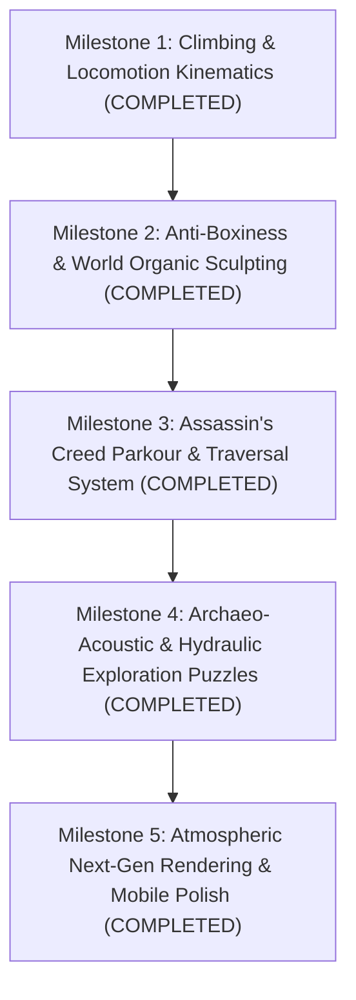

# Juzu — Next-Gen Explorer Master Roadmap

> **Vision**: Transform *Juzu* into the definitive browser-native open-world action-adventure game set in the Inca Andes. Combine the athletic fluid traversal of *Assassin's Creed* with the tactile wonder, archaeological authenticity, and hydraulic puzzle exploration of *Tomb Raider*. Browser-native: WebGPU primary + WebGL2 load-bearing fallback.

---

## 🗺️ Master Progress & Milestone Tracker

---

## Milestone 1: Kinesthetic Locomotion & Climbing Polish (Immediate)

- [x] **1.1 Fix Climbing Wall Standoff Distance**:
  - Increased character distance from crag wall to `crag.centerZ + 0.38`, eliminating body clipping into stone geometry.
  - Files: `src/character/naira.ts`, `src/main.ts`.
- [x] **1.2 Athletic Climbing Animation Refactor**:
  - Implemented hip abduction ($Z = \pm 0.24..0.34\text{ rad}$) to turn knees outward in a natural climber's stance.
  - Reduced thigh forward pitch from $0.85\text{ rad}$ ($49^\circ$) to $0.18 \dots 0.38\text{ rad}$, keeping knees and shins flush with the wall surface.
  - Positioned feet to grip handholds / corbels directly.
- [x] **1.3 Smooth Ledge Mantle & Transition**:
  - Polished mantle pull-up animation onto the lookout platform when reaching top of crag.
- [x] **1.4 Verification**:
  - `npm run typecheck && npm run build`: green.
  - Captured `shots_gameplay/climb_kinematics_verify/frame1.png`: verified zero leg clipping and athletic foothold placement.
  - PR [#2](https://github.com/vy6ycr7tcc-debug/juzu/pull/2) merged into `main`.

---

## Milestone 2: Eradicate "Minecraft Boxiness" & Sculpt Organic World

- [x] **2.1 Organic Mountain Slopes & Andean Contours**:
  - Replaced rigid rectangular hallway trough with natural winding alpine topography ($\text{valleyWidth} = 8.5 + 2.8\sin(0.11z) + \dots$), undulating contour-following andenes, and smooth scree slopes.
  - Files: `src/world/terrain.ts`.
- [x] **2.2 Cyclopean Living-Bedrock Ushnu & Masonry**:
  - Created `createIncaUshnuBedrockGeometry` in `src/world/masonry.ts`: replaced concentric Minecraft box steps with a monumental, sculpted granite living-bedrock altar featuring asymmetric ceremonial Chakana planes, carved ritual seats (*tiana*), and an integrated *Intihuatana* gnomon monolith.
  - Files: `src/world/masonry.ts`, `src/world/regions/highSierra.ts`.
- [x] **2.3 Weathered Andean Ichu Thatch Roofs**:
  - Replaced saturated neon-yellow plastic colors with authentic sun-bleached dried straw tones (`[0.46, 0.40, 0.30]`), deep shadow crevices, and nano-hexagonal micro-relief.
  - Files: `src/world/regions/highSierra.ts`.
- [x] **2.4 Verification**:
  - Captured `shots_gameplay/highSierra_organic_verify/frame1.png` and `shots_gameplay/valley_organic_verify/frame1.png`.
  - PR [#3](https://github.com/vy6ycr7tcc-debug/juzu/pull/3) merged into `main`.

---

## Milestone 3: Assassin's Creed Parkour & Traversal System

- [x] **3.1 Advanced Crag Climbing & Lateral Shimmy**:
  - Horizontal traversal along crag corbels via `input.moveX` with procedural spine/hip weight transfer.
  - Smooth parametric Hermite mantle transition curve pulling onto terrace platforms without teleportation.
- [x] **3.2 Vaulting & Fluid Low-Obstacle Traversal**:
  - Automatic low-obstacle vaulting over curbs and retaining walls while running/sprinting preserving forward momentum.
  - Dedicated one-hand planting and leg clearance animation clip with parabolic clearance arc.
- [x] **3.3 Dynamic Rope Suspension Physics & Zipline Descent**:
  - Q'eswachaka suspension bridge reacts dynamically to player footfalls with resonance sway and vertical sag.
  - High-velocity zipline descent with natural overhead pulley grip suspension, deceleration landing flare, and dynamic camera wind shake & FOV widening.

---

## Milestone 4: Archaeo-Acoustic & Hydraulic Exploration Puzzles

- [x] **4.1 Interactive Inca Hydraulic System (*Paqchas*)**:
  - Operable bronze sluice wheels redirecting mountain glacial streams with water cascade particle plane.
  - Dynamic water levels in lower stone cisterns unlocking submerged temple passageways with counterweight mechanisms.
  - Spatial audio: rushing water acoustics echoing inside stone vaults.
- [x] **4.2 Solar Astronomical Mirror Puzzles (*Inti-k'anchay*)**:
  - Rotating polished bronze solar mirrors reflecting sunlight onto the *Intihuatana* gnomon to trigger ancient mechanical stone counterweights with volumetric golden beam and halo flare.
- [x] **4.3 Quipu Recording & Secret Passages**:
  - Discoverable knotted cord quipus in 3D modal inspector with keyboard navigation, decimal knots, and secret passage blueprints.

---

## Milestone 5: Next-Gen Atmosphere, Tone & Mobile Polish

- [x] **5.1 Volumetric Atmospheric God Rays & Cloud Drift**:
  - 3D crossed-quad volumetric god-ray light shafts piercing cloud forest canopy and high Sierra pass without thinning out from any viewing angle.
  - High-altitude cirrus & cumulus drifting cloud wisps with soft organic edge falloff moving with wind direction.
  - Ambient sunlit dust/mist motes floating and shimmering through light shafts.
- [x] **5.2 Nano-Hexagonal Procedural Relief Tuning**:
  - Balanced nano-hex micro-relief across rock (`andesiteCut`, `fieldstoneRough`), terrain (`groundForestFloor`, `highSierraPuna`), metals (`goldOrnamental`), rime snow (`highSierraSnow`), and braided fibers (`ropeBraided`, `clothQuechuaRed`).
- [x] **5.3 Mobile Touch Controls & Haptics**:
  - Ergonomic dual-stick touch controls with glassmorphic virtual analog joystick, sprint threshold haptic pulses, and intuitive action button cluster.
  - Context-aware action icons and glowing aura for all mechanisms: Takedown, Sluice Wheel, Solar Mirror, Zipline, and Quipu.
  - Safe-area notch padding for landscape and portrait mobile displays.
- [x] **5.4 WebGL2 / WebGPU Zero-Regression Quality Gate**:
  - Zero-error typecheck and production build.
  - Full screenshot verification suite across all regions and gameplay states (`shot=valley`, `shot=highSierra`, `shot=jungleLowlands`, `shot=paititi`, `shot=bridge`, `shot=puzzle`, `shot=solar`, `shot=quipu`, `shot=climb`, `shot=zipline`, `shot=touch=1`).
